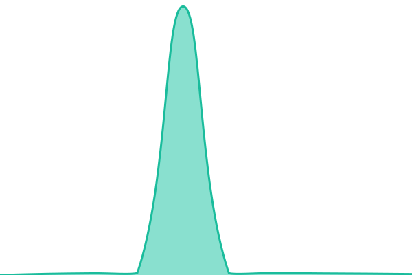

# [📈 Live Status](https://ai8-io.github.io/upptime-status): <!--live status--> **🟩 All systems operational**

This repository contains the open-source uptime monitor and status page for [DeepFlow](www.deepflow.com), powered by [Upptime](https://github.com/upptime/upptime).

With [Upptime](https://upptime.js.org), you can get your own unlimited and free uptime monitor and status page, powered entirely by a GitHub repository. We use [Issues](https://github.com/ai8-io/upptime-status/issues) as incident reports, [Actions](https://github.com/ai8-io/upptime-status/actions) as uptime monitors, and [Pages](https://ai8-io.github.io/upptime-status) for the status page.

<!--start: status pages-->
<!-- This summary is generated by Upptime (https://github.com/upptime/upptime) -->
<!-- Do not edit this manually, your changes will be overwritten -->
<!-- prettier-ignore -->
| URL | Status | History | Response Time | Uptime |
| --- | ------ | ------- | ------------- | ------ |
|  [DeepFlow Website](https://www.deepflow.com) | 🟩 Up | [deep-flow-website.yml](https://github.com/deepflow-ai-inc/upptime-status/commits/HEAD/history/deep-flow-website.yml) | 

 401ms
     
 | 

<a href="https://ai8-io.github.io/upptime-status/history/deep-flow-website">100.00%</a>
    

|  [DeepFlow App](https://app.deepflow.com) | 🟩 Up | [deep-flow-app.yml](https://github.com/deepflow-ai-inc/upptime-status/commits/HEAD/history/deep-flow-app.yml) | 

 266ms
     
 | 

<a href="https://ai8-io.github.io/upptime-status/history/deep-flow-app">100.00%</a>
    

|  [DeepFlow API](https://api.deepflow.com/k8s-probes/liveness) | 🟩 Up | [deep-flow-api.yml](https://github.com/deepflow-ai-inc/upptime-status/commits/HEAD/history/deep-flow-api.yml) | 

 469ms
     
 | 

<a href="https://ai8-io.github.io/upptime-status/history/deep-flow-api">100.00%</a>
    

|  [DeepFlow Authentication](https://auth.deepflow.com/realms/deepflow/.well-known/openid-configuration) | 🟩 Up | [deep-flow-authentication.yml](https://github.com/deepflow-ai-inc/upptime-status/commits/HEAD/history/deep-flow-authentication.yml) | 

 461ms
     
 | 

<a href="https://ai8-io.github.io/upptime-status/history/deep-flow-authentication">100.00%</a>
    

<!--end: status pages-->

[**Visit our status website →**](https://ai8-io.github.io/upptime-status)

## 📄 License

- Powered by: [Upptime](https://github.com/upptime/upptime)
- Code: [MIT](./LICENSE) © [Anand Chowdhary](https://anandchowdhary.com), supported by [Pabio](https://pabio.com)
- Data in the `./history` directory: [Open Database License](https://opendatacommons.org/licenses/odbl/1-0/)
